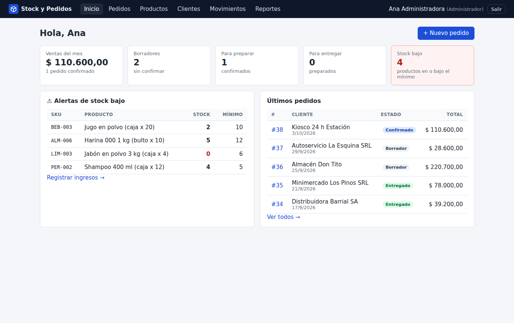
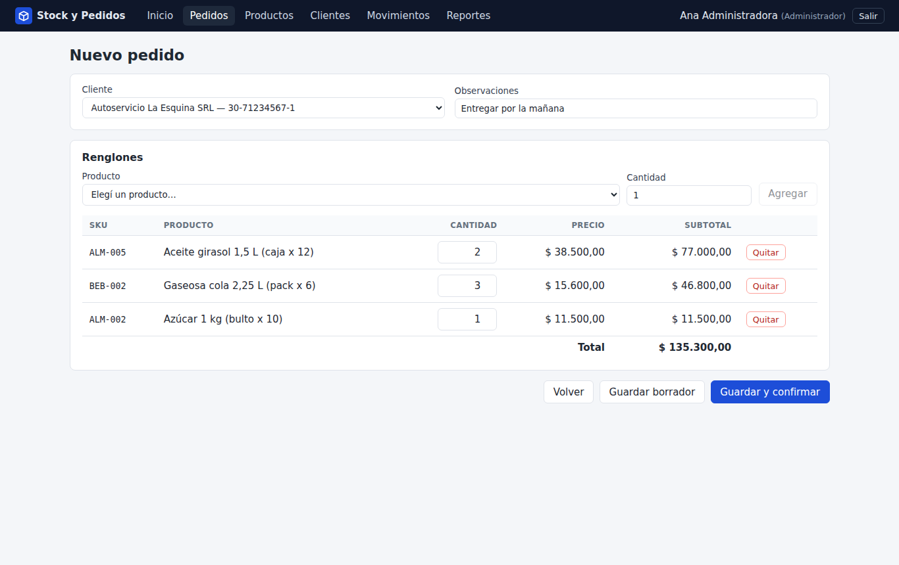
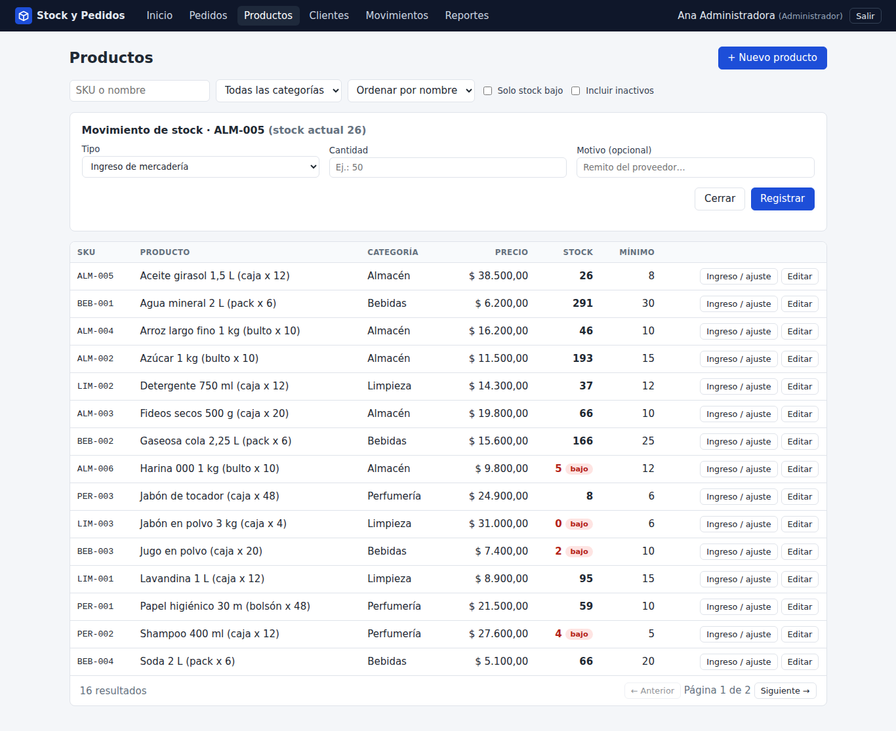
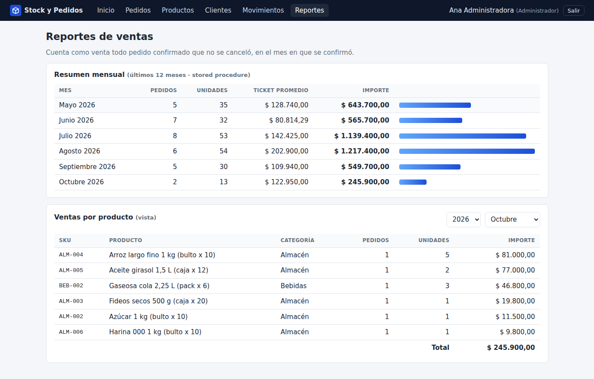
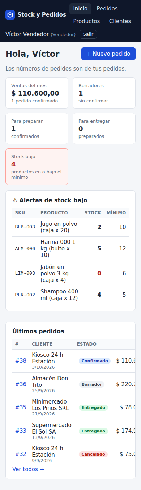

[Versión en castellano](README.md)

# Stock & Orders — ASP.NET Core 10 + EF Core + SQL Server + React

An **inventory and order management system for a small wholesale distributor**: products with SKU and minimum stock, customers, orders with line items and a status workflow, auditable stock movements, low-stock alerts, and sales reports backed by a SQL Server view and stored procedure.

> **Portfolio project.** I built it to practice and showcase what **Junior .NET Developer** and **.NET Backend Developer** job postings ask for (C#, ASP.NET Core, Entity Framework, SQL Server, React/Angular, Git, testing). It is not a real company's system: the distributor, customers, products and tax IDs (CUIT) are **sample data**. The domain names in the code are in Spanish (`Pedido` = order, `Producto` = product, `Cliente` = customer, `Movimiento` = stock movement).
>
> It complements another .NET project of mine (Mesa de Reclamos: Angular + PostgreSQL + SOAP). This one focuses on what that one doesn't have: **SQL Server, EF Core migrations, optimistic concurrency with `rowversion`, a view and a stored procedure, and React**.



## What it does

| Feature | Details |
|---|---|
| Products | Unique SKU (`ALM-001`), category, price, current stock, minimum stock, soft delete. List with search, category filter, "low stock only" and pagination. |
| Customers | Business name, CUIT (Argentine tax ID) validated with its check digit, contact info. |
| Orders | Line items (product + quantity + price frozen when added). Status **Draft → Confirmed → Prepared → Delivered**, or **Cancelled** (`Borrador`, `Confirmado`, `Preparado`, `Entregado`, `Cancelado`). |
| Confirm | Deducts stock for every line **in a single transaction**. If anything is short, nothing is deducted and the API returns 409 with the list of shortages. Safe when two confirmations happen at the same time (see *Technical decisions*). |
| Cancel | If the order had already deducted stock, it is returned. A reason is required. |
| Movements | Every stock change (receipt, sale, cancellation, adjustment) is recorded with user, date, quantity, resulting stock and order reference. |
| Alerts | Dashboard with products at or below their minimum, orders per status and sales this month. |
| Reports | Sales by month and product (**view** `vw_VentasPorMesProducto`) and a monthly summary with average ticket (**stored procedure** `sp_ResumenVentasMensual`), both consumed through EF Core. |
| Users | JWT with roles **Vendedor** (salesperson: creates and confirms their own orders, sees only theirs) and **Administrador** (everything: products, receipts/adjustments, prepare/deliver/cancel confirmed orders, audit log and reports). |

### Demo users

| User | Password | Role |
|---|---|---|
| `admin@demo.local` | `demo1234` | Administrador |
| `vendedor@demo.local` | `demo1234` | Vendedor |

They are seeded only when `Bd:CargarUsuariosDemo` is `true` (in Docker, controlled by `CARGAR_DATOS_DEMO` in `.env`).

## Stack

- **Backend:** C# / .NET 10, ASP.NET Core 10 controllers, FluentValidation, ProblemDetails (RFC 9457), OpenAPI + Swagger UI, JWT Bearer auth, ASP.NET Identity's `PasswordHasher` for passwords.
- **Data:** SQL Server 2022, Entity Framework Core 10 (migrations, `rowversion`, check constraints, indexes, a view mapped as a keyless entity, `SqlQuery` for the stored procedure).
- **Frontend:** React 19 + TypeScript + Vite, React Router, hand-written CSS (no component library). Built into `wwwroot` and served by the API itself.
- **Tests:** xUnit (unit + integration with `WebApplicationFactory` against a **real SQL Server**), Vitest + Testing Library for the frontend.
- **Infra:** multi-stage Dockerfile (Node → SDK → runtime), docker-compose with SQL Server, GitHub Actions.

### Layout

```
src/
  Stock.Dominio/   Entities and rules (Pedido.Confirmar, Producto.AplicarMovimiento, Cuit…). No dependencies.
  Stock.Datos/     DbContext, EF configurations, migrations (including the view and SP).
  Stock.Api/       Controllers, DTOs + validators, services (use cases), JWT, error handling, seed data.
tests/Stock.Tests/ Unitarios/ (unit) and Integracion/ (integration)
web/               React + TypeScript + Vite
```

Deliberately simple layers: business rules live in the domain (and are tested without a database), services load/save and handle transactions and concurrency, and controllers only translate HTTP.

## Running it

### Option 1: Docker (easiest, Windows 10 with Docker Desktop included)

Requirements: Docker Desktop (on Windows 10 with the WSL 2 backend enabled) and about 2 GB of free RAM for SQL Server.

```bash
cp .env.example .env        # PowerShell: Copy-Item .env.example .env
# edit .env: MSSQL_SA_PASSWORD and JWT_CLAVE (32+ characters)
docker compose up --build
```

- App: <http://localhost:8080> (React UI + API)
- Swagger: <http://localhost:8080/swagger>
- SQL Server from your machine (SSMS / Azure Data Studio): `localhost,14330`, user `sa`, password from `.env`.

The API waits for SQL Server to be healthy, applies migrations and loads the demo data. To start from scratch: `docker compose down -v`.

> On Docker Desktop for Windows, if port 8080 is taken, change `API_PUERTO_HOST` in `.env`.

### Option 2: without Docker (Visual Studio / VS Code / Rider)

Requirements: **.NET SDK 10**, **Node 22** and a **SQL Server** (2019/2022, Developer or Express; LocalDB not tested).

1. Set the connection string. `appsettings.Development.json` points to `localhost,1433`, database `stock_dev`, user `sa`, password `Cambiar_Esta_Clave_2026`. Override it with an environment variable or *user secrets*:
   ```bash
   # bash
   export ConnectionStrings__Stock="Server=localhost,1433;Database=stock_dev;User Id=sa;Password=YOUR_PASSWORD;TrustServerCertificate=True"
   # PowerShell
   $env:ConnectionStrings__Stock="Server=localhost,1433;Database=stock_dev;User Id=sa;Password=YOUR_PASSWORD;TrustServerCertificate=True"
   # SQL Server Express with Windows authentication:
   # Server=.\SQLEXPRESS;Database=stock_dev;Trusted_Connection=True;TrustServerCertificate=True
   ```
   No SQL Server installed? Run just the database with Docker: `docker compose up -d sqlserver` (port 14330).
2. API (in Development it migrates and seeds on startup):
   ```bash
   dotnet run --project src/Stock.Api      # http://localhost:5080  and  /swagger
   ```
3. Frontend with hot reload (Vite proxies `/api` to the API on :5080):
   ```bash
   cd web
   npm install
   npm run dev                              # http://localhost:5173
   ```
   Or `npm run build`, which outputs the UI into `src/Stock.Api/wwwroot` so the API serves it directly.

Manual migrations (optional; `dotnet-ef` is in the `.config` tool manifest):

```bash
dotnet tool restore
dotnet ef database update -p src/Stock.Datos -s src/Stock.Datos
dotnet ef migrations add ChangeName -p src/Stock.Datos -s src/Stock.Datos -o Migraciones
```

## Screens

| | |
|---|---|
|  |  |
| **New order**: customer, line items with product search, available stock and live total. | **Products**: search, category, "low stock only", pagination. |
|  |  |
| **Reports**: monthly summary (stored procedure) and sales per product (view). | Responsive on mobile. |

Other screens: login, order list filtered by status/customer/dates, order detail with role- and status-dependent actions, customers, and the stock movement audit log (admin only).

## Main endpoints

All under `/api`, JWT required except login. Errors are returned as **ProblemDetails** (`application/problem+json`).

| Method | Route | Role | What it does |
|---|---|---|---|
| POST | `/auth/login` | — | Returns token, name and role |
| GET | `/auth/yo` | any | Current user |
| GET | `/productos?texto=&categoriaId=&soloStockBajo=&pagina=&tamanio=` | any | Paged list |
| GET/POST/PUT | `/productos`, `/productos/{id}` | Admin (writes) | Create/edit (PUT carries `rowVersion`) |
| POST | `/productos/{id}/movimientos` | Admin | Goods receipt or adjustment with reason |
| GET/POST | `/categorias` | Admin (writes) | Categories |
| GET/POST/PUT | `/clientes`, `/clientes/{id}` | any | Customers |
| GET/POST | `/pedidos?estado=&clienteId=&texto=&desde=&hasta=&pagina=` | any | Salespeople only see their own |
| PUT | `/pedidos/{id}` | any | Edit a draft |
| POST | `/pedidos/{id}/confirmar` | any | Deducts stock (409 if short) |
| POST | `/pedidos/{id}/preparar`, `/pedidos/{id}/entregar` | Admin | Moves the status forward |
| POST | `/pedidos/{id}/cancelar` | Salesperson (own draft) / Admin | Returns stock when applicable |
| GET | `/movimientos?productoId=&tipo=&pedidoId=&desde=&hasta=` | Admin | Stock audit log |
| GET | `/dashboard` | any | Low stock, orders per status, sales this month |
| GET | `/reportes/ventas-por-producto?anio=&mes=&categoria=` | Admin | Reads the view |
| GET | `/reportes/resumen-mensual?desde=&hasta=` | Admin | Runs the stored procedure |
| GET | `/salud` | — | Health check |

Status codes used: 400 (validation, with per-field errors), 401, 403, 404, 409 (out of stock or concurrency conflict), 422 (business rule: invalid transition, duplicate SKU, etc.).

## Technical decisions

- **Confirming an order is atomic and concurrency-safe.** `Producto` and `Pedido` have a `rowversion` column. On confirm, the service opens a transaction, loads the order and its products, the domain checks and deducts stock, and EF issues `UPDATE … WHERE Id = @id AND RowVersion = @read`. If another user changed the same product in between, the UPDATE affects no rows, EF throws `DbUpdateConcurrencyException`, **everything** (stock, status, movements) is rolled back and the operation is retried with fresh values (up to 3 times). On retry there may no longer be enough stock → 409. SQL Server deadlocks (error 1205) are retried too. Integration tests fire confirmations in parallel and check that stock is never oversold or deducted twice.
- **Optimistic concurrency on edits too.** The product PUT receives the `rowVersion` the user saw; if it changed, 409 instead of silently overwriting someone else's change.
- **Database-level defenses in addition to code:** check constraints (`Stock >= 0`, `Cantidad > 0`, non-negative price), unique indexes (SKU, CUIT, email, same product twice in one order).
- **Price frozen on the line item:** if the list price changes tomorrow, old orders keep their totals.
- **Movements as an audit log:** stock is never changed directly; it always goes through `Producto.AplicarMovimiento`, which creates the movement with the resulting stock. A negative adjustment that would leave negative stock is rejected.
- **View and stored procedure inside a migration** (`migrationBuilder.Sql`), so they are versioned with the schema and tests create them exactly like production. The view is mapped as a keyless entity (`ToView`) and supports LINQ filters; the SP is called with `Database.SqlQuery<T>` using interpolated parameters (EF turns them into SQL parameters, so no SQL injection).
- **Enums stored as text** (`Confirmado`, not `2`): the database is readable without the code.
- **UTC dates** via a `ValueConverter`, so JSON carries `Z` and the browser shows local time.
- **Uniform errors:** an `IExceptionHandler` maps domain exceptions to ProblemDetails (404/409/422) and a filter runs FluentValidation before the controller (400 with per-field errors).
- **The API serves the built frontend** (`wwwroot` + fallback to `index.html`): one container, no CORS.
- **Seed with history:** ~38 orders over the last months in different statuses, so reports and the dashboard have something to show on first run.

## Tests

```bash
# Backend: 76 tests (unit + integration). Needs a SQL Server; uses/creates the stock_test database.
export STOCK_TEST_BD="Server=localhost,1433;Database=stock_test;User Id=sa;Password=YOUR_PASSWORD;TrustServerCertificate=True"
dotnet test

# Frontend: 9 tests with Vitest + Testing Library
cd web && npm test
```

PowerShell: `$env:STOCK_TEST_BD="..."`. Without the variable it uses `localhost,1433` with the `.env.example` password. With `docker compose up -d sqlserver` you can point it to `localhost,14330`.

Coverage:

- **Unit (domain and validators):** full status transition matrix, confirming without stock changes nothing and reports every shortage, cancelling returns stock, can't confirm twice, totals use the frozen price, adjustments that would make stock negative, CUIT check digit, SKU format, request validation.
- **Integration (full API with `WebApplicationFactory` + real SQL Server, database recreated from migrations):** login and 401/403 by role, full Draft → Delivered cycle, 409 with shortages and nothing deducted, cancellation with auditable movements, salespeople can't see others' orders, **simultaneous confirmations competing for the same stock**, **the same order confirmed twice at once deducts only once**, editing with a stale `rowversion` → 409, the database rejects negative stock even when code is bypassed, view and stored procedure with known data, filters and pagination, Swagger/OpenAPI respond, enums stored as text.

Last run: **76/76 xUnit and 9/9 Vitest passing.** CI (`.github/workflows/ci.yml`) runs the same with SQL Server as a service, checks for missing migrations (`dotnet ef migrations has-pending-model-changes`), builds the frontend and builds the Docker image.

## Not included / not tested

- **No** user sign-up or password recovery (users come from the seed), no refresh tokens: the JWT lasts 8 hours.
- **No** suppliers or purchase orders: goods receipts are recorded as a movement with a comment.
- **No** invoicing, taxes, per-customer price lists or discounts.
- Reports group by calendar month in **UTC** (an order confirmed on the last day of the month at 10 pm Argentina time lands in the next month).
- **Tested:** test suites on Linux against SQL Server 2022 in a container; `docker compose up` with the built image, login, create → confirm → cancel an order, reports and Swagger against the container.
- **Not tested:** Windows 10 with Docker Desktop (the instructions are the standard ones, I didn't run them on Windows), SQL Server Express/LocalDB, or the GitHub Actions workflow actually running on GitHub (not pushed yet). In the environment where I built it, `docker compose build` needed a network proxy certificate added so `dotnet restore` could download packages; a normal machine doesn't need that and the repo's Dockerfile is the clean one.
- No load testing: concurrency is tested with 8 parallel confirmations on the same product, not thousands of users.

## How to talk about it in an interview

1. **What it is:** an end-to-end inventory and order system for a small distributor: ASP.NET Core 10 API, EF Core on SQL Server, React + TypeScript frontend, tests and Docker.
2. **The interesting problem is concurrency:** two salespeople confirming orders for the same product at the same time. I solved it with optimistic concurrency (`rowversion`) + a transaction + retry, and proved it with a test that confirms orders in parallel.
3. **Rules in the domain:** `Pedido.Confirmar` validates the transition and stock and returns the movements; that's tested without a database. The service only orchestrates and saves.
4. **Real SQL Server, not just EF:** migrations, check constraints, unique indexes, a view mapped in EF and a stored procedure called via `SqlQuery`, all versioned in migrations.
5. **A tidy API:** FluentValidation, ProblemDetails with consistent status codes (400/404/409/422), Swagger with JWT, roles.
6. **Auditing:** every stock change is a movement with user and resulting stock; cancelling returns stock with its own movement.
7. **Integration tests against real SQL Server** with `WebApplicationFactory`, not InMemory, because InMemory doesn't honor `rowversion`, constraints or transactions.

**Likely questions**

- *Why optimistic concurrency instead of a lock?* — Conflicts are rare; I didn't want to hold row locks while someone builds an order. On conflict: rollback and retry. `UPDATE … SET Stock = Stock - @n WHERE Stock >= @n` would also work; I chose `rowversion` because EF supports it natively and it also protects edits.
- *What if it fails halfway through confirming?* — It's all one transaction: either all stock is deducted, the status changes and movements are written, or nothing happens.
- *Why not the InMemory provider for tests?* — It doesn't support `rowversion`, transactions or the view/SP; the concurrency test would prove nothing.
- *When would you use a stored procedure instead of LINQ?* — For aggregate-heavy reports best done in the engine, or shared with another system (e.g. BI). LINQ for CRUD.
- *How do you handle errors?* — Typed domain exceptions → an `IExceptionHandler` turns them into ProblemDetails; stack traces are never returned.
- *What would you add?* — Refresh tokens, suppliers and purchase orders, local-time-zone reports, and structured logging with Serilog.
- *Why React and not Angular?* — My other .NET project uses Angular; here I wanted to show React with TypeScript, which many postings also ask for.

---

Author: Joaquín Alejandro Bobbio — Programming degree student (Licenciatura en Programación, UNAHUR). Portfolio project with sample data.
